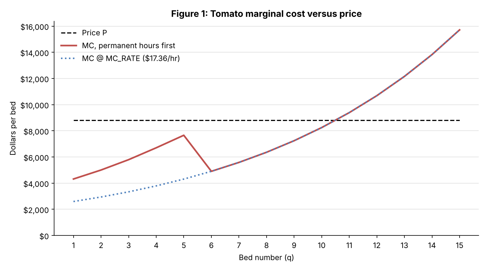
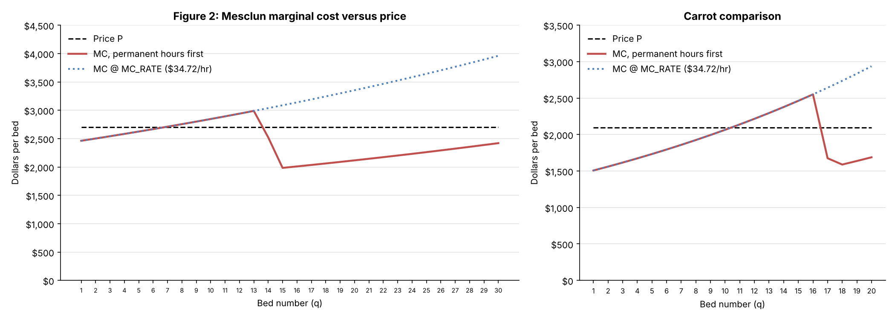

# Perfect Competition Stage 3: Analysis

## Notes

- Expected mix in the supplied specification: 10 tomato beds, 20 carrot beds, 30 mesclun beds.
- Workbook profit at that mix using rounded inputs: $42,775.16. published comparison: $42,762.
- $13.16 gap attributed to rounded labor rates and carrot hours.
- All workbook checks passed

## Analysis

### 1. Where does the money crop stop, and why there?

**Workbook evidence:**

- Highest revenue per bed: tomato, $8,800, against mesclun $2,700 and carrot $2,094.
- Optimal tomato beds: 10. Cap is 20, slack 10, so tomatoes stop well short of the cap.
- Last bed planted (bed 10): 424.43 marginal labor hours; marginal cost $8,248.11, $551.89 under price. Removing it lowers profit by $551.89.
- Next bed not planted (bed 11): 490.22 marginal hours; labor $8,510.17 + fertilizer $880 = marginal cost $9,390.17, $590.17 over price. Adding it changes profit by −$590.17.
- Marginal labor rate at the optimum: $17.36/hr, because all 720 permanent hours are already used.
- Stage 1 hypothesis (12 tomato beds): earns $40,298.02, $2,477.13 below the optimum. Bed 12 alone has MC $10,686.96, $1,886.96 over price.

### 2. Binding constraints and the value of relaxing them

| Constraint | Optimal usage / limit | Binding or slack? | Shadow price / evidence |
| --- | --- | --- | --- |
| Carrot bed cap (`CARROT_BEDS ≤ 20`) | 20 / 20 | Binding (slack 0) | +$353.10 for bed 21. Re-solved: +$651.82 at 22, +$894.24 at 23, +$1,078.42 at 24, where the 64-bed farm limit takes over. |
| Mesclun bed cap (`MESCLUN_BEDS ≤ 30`) | 30 / 30 | Binding (slack 0) | +$246.57 for bed 31. Re-solved: +$459.13 at 32, +$637.06 at 33, +$779.75 at 34 (64 beds). |
| Tomato bed cap (`TOMATO_BEDS ≤ 20`) | 10 / 20 | Slack (10 beds) | $0. Tomatoes stop on marginal cost, not the cap. |
| Farm beds (`TOTAL_BEDS_USED ≤ 64`) | 60 / 64 | Slack (4 beds) | $0 at current caps. If both caps are lifted, the re-solved optimum is 10/23/31 = 64 beds, $43,915.97 (+$1,140.82), and a 65th bed of ground is then worth +$212.55. |
| Temp hours (`TEMP_HOURS_USED ≤ 5,760`) | 4,556.8 / 5,760 | Slack (1,203.2 hrs) | $0 for a 5th worker. The 4th worker is needed: with 3 workers (4,320 hrs) the re-solved optimum is 9/20/30, $42,223.27 (−$551.89). FTE used 3.16. |
| Total labor (`TOTAL_LABOR_HOURS ≤ 6,480`) | 5,276.8 / 6,480 | Slack (1,203.2 hrs) | $0. Same slack as temp hours, since permanent hours are used first. |
| Permanent hours (allocation rule, not a Solver constraint) | 720 / 720 | Fully used | Not a choice variable: sets the marginal hour at $17.36. |
| Integer and non-negativity | All integer, all > 0 | Not binding | – |

**Method reflection:**

- Solver here is GRG Nonlinear with integer decision cells.

### 3. Does any marginal-cost curve fall?

| Crop | Bed q | Hours q−1 to q | Marginal hrs | Rate(s) on those hours | MC (perm-first) |
| --- | ---: | --- | ---: | --- | --- |
| Tomato | 5 | 527.08 to 724.73 | 197.65 | 192.92 h @ $34.72 + 4.73 h @ $17.36 | $7,660.43 |
| Tomato | 6 | 724.73 to 956.64 | 231.91 | all @ $17.36 | $4,906.02 (falls $2,754) |
| Carrot | 16 | 651.47 to 712.28 | 60.80 | all @ $34.72 | $2,551.12 |
| Carrot | 17 | 712.28 to 775.71 | 63.44 | 7.72 h @ $34.72 + 55.71 h @ $17.36 | $1,675.33 (falls) |
| Carrot | 18 | 775.71 to 841.88 | 66.16 | all @ $17.36 | $1,588.61 (falls); rises from bed 19 |
| Mesclun | 13 | 626.81 to 687.53 | 60.72 | all @ $34.72 | $2,988.27 |
| Mesclun | 14 | 687.53 to 749.67 | 62.14 | 32.47 h @ $34.72 + 29.67 h @ $17.36 | $2,522.48 (falls) |
| Mesclun | 15 | 749.67 to 813.26 | 63.59 | all @ $17.36 | $1,983.89 (falls); rises from bed 16 |

**Workbook evidence summarized notes:**

- Marginal labor hours rise at every bed for all three crops (Marginal Cost sheet); physical diminishing returns never reverse. Each dip happens at the bed where cumulative hours pass `PERMANENT_FIELD_LABOR_HOURS` = 720 and the rate on the next hour falls from $34.72 to $17.36.
- MC falls once for tomatoes and twice each for carrots and mesclun (Marginal Cost and Checks sheets).
- The single-rate schedules never fall (confirmed on the Checks sheet), because one rate is applied to rising hours.
- Consequence for V3: at `MC_RATE` = $34.72 the standalone P = MC points are carrot 10 and mesclun 6. Priced the way the farm actually pays (permanent first, then $17.36), they are 20 and 30, the caps.

#### Figure 1: Tomato marginal cost versus price

Price $8,800; MC $8,248.11 at bed 10 and $9,390.17 at bed 11, so the crossing sits between beds 10 and 11. The dip from $7,660.43 to $4,906.02 is bed 6, where the 720 permanent hours run out.

#### Figure 2: Mesclun marginal cost versus price

At `MC_RATE` $34.72 the MC line crosses the $2,700 price between bed 6 ($2,667.21) and bed 7 ($2,710.59), the V3 point. Priced permanent-first, MC drops to $1,983.89 at bed 15 and is $2,420.00 *at* bed 30, still $280 under price, so the cap ends production, not marginal cost. Carrot comparison: MC $1,688.37 at bed 20, $405.63 under price (matches the Optimization sheet).

### 4. Would each crop make money on its own?

**Workbook evidence:**

- Standalone variable cost = fertilizer + labor priced permanent hours first, with that crop alone; fixed cost $20,000 is charged in full to the one crop. AVC = variable cost / beds; ATC = (variable + fixed) / beds.
- Inside the optimum, each crop adds profit: dropping carrots gives $26,756.16, negitive $16,019.00; dropping mesclun gives $22,195.17, negative $20,579.99; dropping tomatoes gives $4,099.79, negative $38,675.37.
- Blended-rate crop contribution (reporting only, average not marginal): tomato $33,145.95, carrot $13,691.10, mesclun $15,938.10.

| Crop | Standalone beds tested | Revenue − variable costs | After fixed cost | MC / AVC / ATC conclusion |
| --- | --- | --- | ---: | --- |
| Tomato | 10 (best alone) | $88,000 − $61,823.83 = $26,176.17 | +$6,176.17 | P $8,800 > ATC $8,182.38 > AVC $6,182.38; MC bed 10 $8,248.11 ≤ P. Profitable alone. |
| Carrot | 20 (best alone) | $41,880 − $38,360.20 = $3,519.80 | −$16,480.20 | P $2,094 > AVC $1,918.01 but < ATC $2,918.01. Covers variable cost, not the $20,000 fixed cost. |
| Mesclun | 30 (best alone) | $81,000 − $72,919.21 = $8,080.79 | −$11,919.21 | P $2,700 > AVC $2,430.64 but < ATC $3,097.31. Covers variable cost, not fixed. |

### Stage 1 hypothesis reflection

My initial prediction was wrong. The proposed number of tomato beds exceeded the optimized amount. The intent was correct and aligned with the optimized solution that not all beds would be utilized because beyond a threshold, those beds would be financially detrimental to maintain and operate.

The recommendation built on this evidence is in [the decision memo](../docs/decisions/2026-10-28-perfect-competition-memo.md). Figure data and editable Excel charts: [perfect-competition-figures.xlsx](figures/perfect-competition-figures.xlsx); source model: [model.xlsx](../capabilities/marginal-analysis/model.xlsx).
